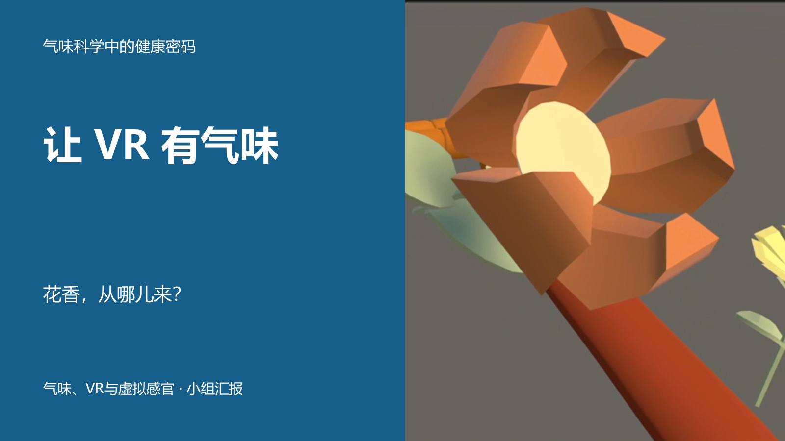

# 让 VR 有气味

### 怎样实现，什么时候有用

上海交通大学《气味科学中的健康密码》小组汇报 · 2026–2027 学年第一学期

> 花在画面里，香味从哪儿来？从一次闻花，看看鼻子怎样参与VR。

这份协作初稿用一次“闻花”的体验串起科学原理、释香装置与效果证据。希望同学听完后，能大致说清虚拟嗅觉怎样工作，举出一种实际应用方式，也知道面对“数字气味”“沉浸”“疗愈”等宣传应当查什么。

## 先看初稿，再改自己的部分

| 你现在要做什么 | 直接打开 |
| --- | --- |
| 快速看完整汇报 | [主讲PDF](release/v1/olfaction-vr-v1-main.pdf) · [含备课PDF](release/v1/olfaction-vr-v1.pdf) · [可编辑 PPTX](release/v1/olfaction-vr-v1.pptx) |
| 看怎样讲、怎样衔接 | [全场口播](release/v1/全场口播.md) · [打印PDF](release/v1/全场口播.pdf) |
| 准备同学和老师的追问 | [问答与备课](release/v1/问答与备课.md) · [打印PDF](release/v1/问答与备课.pdf) |
| 看论文与证据范围 | [论文综览](research/2026-11-01/论文综览.md) · [证据规则](docs/evidence-and-reuse.md) |
| 开始本组修改 | 下方分组入口 · [怎样交稿](CONTRIBUTING.md) |

**这是供大家精修的初稿。** 各组可以改内容、换案例、补证或重写；共同维护全场问题、证据标准和 12 分钟时长。AI 整理与检查和成员人工复核分别记录，论文、数字与图示仍须由成员打开原始来源确认。

## 四组，共同讲一个问题

| 组别 | 负责人／成员 | 本组要让听众明白什么 | 修改入口 |
| --- | --- | --- | --- |
| 0 总体策划与整合 | 陈云海 | 一场完整的故事，讲完还能记住什么 | [整合区](groups/00-integration/README.md) |
| 1 科学原理 | 朱轶宸；刘昌镇、潘力熔 | 鼻子怎样感知气味，为什么给 VR 加香有难度 | [第一组](groups/01-science/README.md) |
| 2 技术与设备 | 蔡天怿；娄嘉恒、王叶 | 程序怎样控制气味到达鼻子，装置还卡在哪里 | [第二组](groups/02-technology/README.md) |
| 3 多感官与应用 | 陈柔羽；杨绎麟、邓沐熙、隋沅辰 | 多出的气味在什么任务中有用，证据支持到哪一步 | [第三组](groups/03-applications/README.md) |

陈云海主要对接三位内容组组长。各组自行安排工作量、协作形式和发言人；**每个人至少完成一项实际工作，最终 PPT 末页逐人说明贡献。** 组长负责组织协作，发言人可另选，本次按 4 人讲述设计。

## 怎样改，合起来才省力

1. **先看全场，再进本组。** 知道前一组讲了什么、后一组需要什么，减少重复。
2. **从本组文稿和建议开始改。** 不需要理解代码。想直接调页面，也可以改本组 PPTX，连同对应口播和来源一起交回。
3. **由第 0 组更新统一总稿。** 各组代表汇总后提 PR，也可先交文件或意见；整合者把改动合入内容源，统一版式、转场与用时。

内容可以改得很大。改到相邻组的术语、承接结论或时间预算时，请一并说明影响，让组长和第 0 组一起协调。总 PPTX 同时被多人改容易覆盖，因此平时优先使用各组副本；具体例子见 [协作与合稿](docs/协作合稿.md)。

## 课程要求与安排

| 项目 | 当前要求 |
| --- | --- |
| 选题 | 气味、VR与虚拟感官 |
| 讲述与互动 | 汇报 12 分钟，超时扣分；另有 2–3 分钟互动提问 |
| 上台与提交 | 最多 4 人上台；PPTX 或 PDF，由小组长提交 |
| 内容与版面 | 分工明确、逻辑清晰、内容完整、排版合理；PPT 最后一页附分工表 |
| 提交控制时间 | 截图正文为 **2026-11-25 17:00（北京时间）**；顶部为同日 23:59，确认前按较早时间准备 |
| 小组协作 | 计划 11 月 10 日前后正式启动，第十一周汇报；具体上台日期与顺序待确认 |

要求的原始依据及时间差异见 [作业要求](docs/requirements.md)。旧公告中的 10 月 21 日和国庆集中准备安排已失效。

## 正式启动前与合稿前

- 各组组长建立小群，组内推选一位 GitHub 代表，最好由组长担任；把用户名发给陈云海核对并邀请。仓库公开，阅读最新版本无需邀请。
- 先依据初稿讨论本组怎样分工，再由组长组织第一轮修改。每位成员的具体工作记录在 [分工与贡献表](docs/team.md)。
- 合稿后完整试讲，核对换人、翻页和媒体时间；找未参与制作的同学复述，检查是否听懂；最终由成员确认贡献页并完成 Canvas 提交。

[推进清单](docs/roadmap.md) · [项目方向](docs/project-brief.md) · [证据与复用记录](docs/evidence-and-reuse.md) · [怎样参与](CONTRIBUTING.md)

[来源手册](release/v1/来源手册.md) · [首稿检查与试讲安排](release/v1/验收说明.md)
