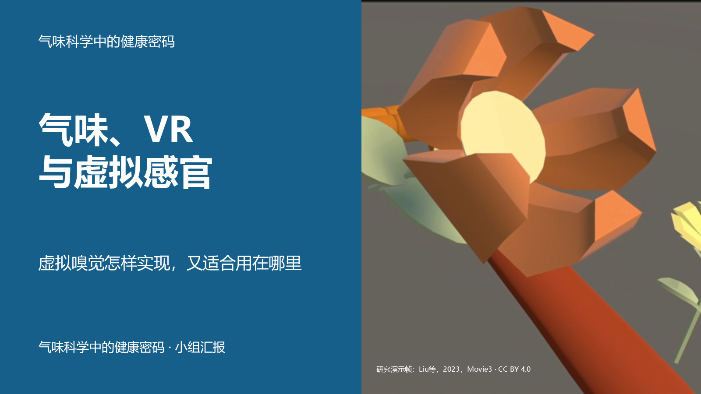

# 气味、VR与虚拟感官

### 虚拟嗅觉怎样实现，又适合用在哪里

上海交通大学《气味科学中的健康密码》小组汇报 · 2026–2027 学年第一学期

**v3 协作初稿** · [主讲 PDF](release/v3/olfaction-vr-v3-main.pdf) · [可编辑 PPTX](release/v3/olfaction-vr-v3.pptx) · [全场口播](release/v3/全场口播.md)

2026-11-14已合入第二组建议、文稿与贡献表，并同步总稿及组包；[本次修正与合稿记录](release/v3/PR合稿记录.md)。

> 画面里的花怎样让鼻子也闻到？了解它怎样实现，再看它适合解决什么问题。

这份初稿先讲清嗅觉基础，再展开一套释香装置；用虚拟酒窖的任务与结果说明应用，以放松实验作短对照，最后给出个人了解、体验和判断宣传的方法。闻花用于引入和技术解释，应用段会进入各自真实的任务。

## 按你的需要打开

| 现在要做什么 | 入口 |
| --- | --- |
| 先看课堂要讲的内容 | [主讲 PDF](release/v3/olfaction-vr-v3-main.pdf) |
| 改页面或查看备课 | [PPTX](release/v3/olfaction-vr-v3.pptx) · [含备课 PDF](release/v3/olfaction-vr-v3.pdf) |
| 看怎样讲、怎样衔接 | [全场口播](release/v3/全场口播.md) · [打印 PDF](release/v3/全场口播.pdf) |
| 准备追问或核查依据 | [问答与备课](release/v3/问答与备课.md) · [来源手册](release/v3/来源手册.md) |
| 开始本组修改 | 下方分组入口 · [怎样交稿](CONTRIBUTING.md) |
| 了解全场如何合在一起 | [叙事与合稿基准](docs/叙事与合稿基准.md) · [协作办法](docs/协作合稿.md) |
| 看更广的论文地图 | [论文综览](research/2026-11-01/论文综览.md) · [证据规则](docs/evidence-and-reuse.md) |

初稿帮助大家统一方向，之后交给各组精修。**案例、图示和讲法都可以改。** 合稿时看听众是否理解、证据是否准确、前后是否顺畅；共同守住12分钟。成员人工复核、真人试讲和实际贡献分别记录，完成后再确认。

## 四章内容，四组协作

1. **嗅觉感知的科学基础**：鼻子感知什么，呈现气味需要满足什么要求。
2. **虚拟嗅觉的技术实现**：一套装置如何配合动作释香，连续使用还有哪些难点。
3. **应用场景与实验结果**：气味在具体任务中承担什么作用，研究测到了什么。
4. **体验途径与效果判断**：自己怎样进一步了解和尝试，怎样判断用途与宣传。

| 组别 | 负责人／成员 | 负责内容 | 修改入口 |
| --- | --- | --- | --- |
| 0 总体策划与整合 | 陈云海 | 开场、第四章、全场合稿 | [整合区](groups/00-integration/README.md) |
| 1 科学原理 | 朱轶宸；刘昌镇、潘力熔 | 第一章，S01–S02 | [第一组](groups/01-science/README.md) |
| 2 技术与设备 | 蔡天怿；娄嘉恒、王叶 | 第二章，T01–T03 | [第二组](groups/02-technology/README.md) |
| 3 多感官与应用 | 陈柔羽；杨绎麟、邓沐熙、隋沅辰 | 第三章，A01–A03 | [第三组](groups/03-applications/README.md) |

陈云海主要对接三位组长。各组自行安排工作量、协作形式和发言人；每个人至少完成一项实际工作，最终PPT末页逐人说明贡献。组长负责组织，发言人可另选，全组上台最多4人。

## 怎样改，合起来才省力

先看全场，再改本组文稿或填写建议。也可以直接改本组PPTX，连同对应口播和来源一起交回；无需安装工具或理解代码。代表汇总后提PR，也可先交文件与意见。

第0组把确认的修改合入总稿，统一视觉和转场。换案例影响上下段时，连同交接和用时一起说明。**当前页数和讲法是参考，合稿看的是实际效果。** 具体办法见 [怎样参与](CONTRIBUTING.md) 和 [协作与合稿](docs/协作合稿.md)。

## 课程要求与安排

| 项目 | 当前依据与安排 |
| --- | --- |
| 汇报与问答 | 12分钟，超时扣分；另有2–3分钟互动 |
| 本稿节奏 | 12页主讲，内容设计预算11分25秒，另留35秒换人和停顿；按真人试讲调整 |
| 备课与分工 | 另有8页备课／参考，完整文件最后一页为11人分工 |
| 上台与提交 | 最多4人上台；PPTX或PDF，由小组长提交 |
| 内容要求 | 分工明确、逻辑清晰、内容完整、排版合理；PPT最后一页附分工表 |
| 提交控制时间 | 截图正文为 **2026-11-25 17:00（北京时间）**；顶部为同日23:59，确认前按较早时间准备 |
| 小组协作 | 计划11月10日前后正式启动，第十一周汇报；具体上台日期与顺序待确认 |

要求与时间差异见 [课程要求](docs/requirements.md)。按笔记本和手机设计讲述，静态图可独立讲完；课后入口分别说明能观看、能操作以及需要额外硬件的部分。

各组先建小群，推选一位GitHub代表，最好由组长担任，把用户名发给陈云海核对并邀请。仓库公开，阅读无需邀请。精修后完成原文复核、全场试讲与贡献确认，再由小组长提交Canvas。

[推进清单](docs/roadmap.md) · [项目方向](docs/project-brief.md) · [贡献表](docs/team.md)

历史版本：[v2主讲PDF](release/v2/olfaction-vr-v2-main.pdf) · [v2 PPTX](release/v2/olfaction-vr-v2.pptx) · [v1主讲PDF](release/v1/olfaction-vr-v1-main.pdf) · [v1 PPTX](release/v1/olfaction-vr-v1.pptx)。本轮精修以v3为准。

[本轮补证与入口实测](research/2026-11-03-v3/README.md) · [课堂演示与分享](release/v3/课堂演示与分享.md) · [16.6秒闻花短片](assets/v3/flower-demo.mp4)
