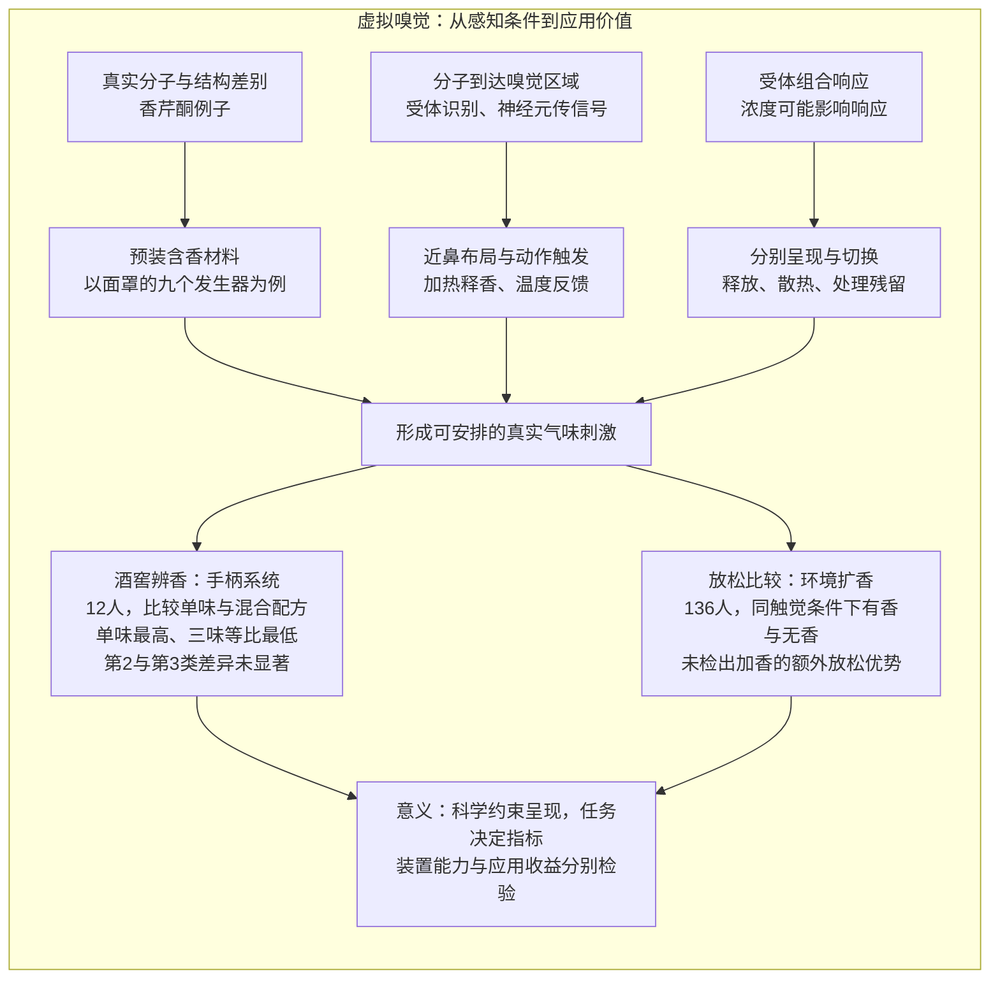

# 整场叙事改进草案（已批准）

2026-11-19。依据陈云海附图、与第一组组长的沟通及当前主分支52f1b5e。这份文档保留前一轮已批准草案。本轮实施改由整合侧完成S05，并精简目录、加入在场感对照和答辩往返导航。当前以[走稿](当前审阅与走稿.md)为准。

## 对本次要求的理解

整场用同一张逻辑图逐步展开：科学基础说明感知条件，装置实现说明怎样在虚拟场景中满足这些条件，实际应用说明这些能力怎样进入任务及实验，最后把整条链收束为用途与意义。目录先给简图，正文反复出现同一组具体概念，答辩总结再把细节填全。

附图的三列适合表达“科学点—对应的实现点”，外框与底部归纳适合表达“这些联系共同说明什么”。目录以少量文字展示骨架，最终总结保留同一骨架、增加具体对象、结果和限制。

## 一、目录O02：三个阶段与一个总问题

总问题：虚拟嗅觉怎样从感知机制走向实际用途？

外框：从感知条件到应用价值。

从上到下三层，每层内部横排关键词：

1. 科学基础——鼻子需要怎样的刺激？分子、到达、组合响应。
2. 装置实现——怎样让刺激配合场景？材料、释放、残留与切换。
3. 实际应用——这些能力怎样进入具体任务？辨香表现、放松比较。

三层用实线箭头相连，共同落到底部：把科学条件转成可控呈现，再用任务和对照判断价值。

拟口播：刚才看到了闻花的效果。接下来沿着这条路线看：鼻子需要什么刺激，装置怎样把它送到位，再看这些能力放进辨香和放松任务后，研究测到了什么。最后把三部分连起来，判断这种技术的意义。

## 二、第一组第五页与第二组的对接约定

以三条对应关系作为暂拟骨架，等组长返稿后校准。这里是根据科学原理提出工程要求，再对应已有装置做法；具体装置证据来自P02，属于本组的讲述组织。

| 前面已经讲到的科学点 | 因此需要解决的呈现问题 | 第二组具体接住的位置 |
| --- | --- | --- |
| 气味来自真实分子，空间结构也可能影响气味（S01、S02） | 提供合适的真实材料 | T01：预装香料与石蜡混合的含香材料 |
| 分子需要到达嗅觉区域，才进入受体与神经元的感知过程（S01、S03） | 安排刺激到达的路径和出现时机 | T01/T02：近鼻布局、VR动作触发加热释香 |
| 受体以组合方式响应，浓度也可能影响响应（S04） | 呈现的材料、剂量与混合情况需要管理和检验 | T01/T03：分别选择发生器、安排释放与散热、处理残留和下一次刺激 |

第三条表达的是工程推论。组合响应原理没有给出通用混香配方，也没有规定发生器数量；装置的温度反馈用于加热控制，与直接测量鼻端浓度分开表述。

## 三、第二、三部分怎样重现科学内容

采用“图中一处可读的呼应＋口播一句承接”，优先替换现有重复说明。科学段的分子图、通路与组合示意仅以简化符号或关键词重现，保留主装置图和实验结果图的主导位置。

| 页面 | PPT上的具体呼应 | 拟替换或加入的口播 |
| --- | --- | --- |
| T01 装置结构 | 真实材料→分子来源；近鼻发生器→刺激到达 | 前面说鼻子需要收到真实分子，这套面罩先把含香材料放到靠近鼻子的发生器里。随后继续原有结构说明。 |
| T02 动作同步 | 控制链最后一格“分子到达鼻子”与科学通路使用同一图示 | 这里控制的是科学段所说的实际刺激：它什么时候到达，要与拿近花朵的动作配合。 |
| T03 残留切换 | 旧分子与下一次刺激相遇的示意，点出混合干扰 | 前面讲过浓度可能影响响应；旧气味未散去时，下一次实际刺激也会改变。然后讲释放、散味与下一次呈现。 |
| A01 酒窖任务 | 气味刺激→辨认→作答→反馈，重现“不同刺激可被区分” | 既然不同气味可以被辨认，就可以让气味本身成为题目。该研究用的是另一套手柄式装置。 |
| A02 辨香结果 | 混合刺激→答题表现；保持原图、SD与显著性说明 | 混合以后人能否认对，直接看这项测试的结果。之后沿用原来的读图和结论。 |
| A03 放松比较 | 增加气味刺激→同条件下比较额外收益 | 这里把气味加入放松体验；要看是否更有帮助，就比较同样触觉条件下的有香与无香。 |

A04现稿末句仍指向已删除的体验入口，建议改接效果判断：下面用一句宣传来试着判断，装置能做什么、应用多带来多少帮助，各要看什么依据。

## 四、QA总结：保留细节的整场关系图

目录中的同一骨架，在最后展开为科学三点、工程三点、两个应用研究及意义。保留具体对象与关键数字，让答辩时能够指图定位。

箭头到应用表达共同的呈现原则进入不同系统。面罩、酒窖手柄、放松实验的环境扩香在图中分别标明，保留各自研究身份。

正式横版图拟用：上排三个科学点；第二排三个对应实现点；第三排两个应用及结果；底部意义。科学／技术／应用沿用固定颜色，目录、贯穿提示和最终图一一对应。正文优先24–26px以上，减少句子而保留可识别的细节。

拟总结口播：回看这张图，虚拟嗅觉先要让真实分子形成合适的刺激，再由装置安排材料、释放和切换。进入应用以后，气味可以成为辨香的题目，也可以是放松体验里增加的一种刺激。是否有价值，要看具体任务和相应的比较证据。我们停在这张图，欢迎提问。

## 五、范围、时间与审批

本轮拟修改O02、T01–T03的局部图文、A01–A03的少量呼应、A04末段、QA。S01–S04及原有装置图片、实验数据和主要结论保留；S05由组长返回后接入。

优先用替换减少重复。建议A04由45秒压到30秒，把15秒移给QA，QA由15秒到30秒；675秒内容加45秒换人停顿的总预算保持。最终图的信息用于答辩定位，主讲只走一遍主线。

待批准的核心选择：目录与总结共用骨架；科学—技术三组对应关系；二三部分采用可见的局部呼应；最终图保留研究细节与各系统身份。

## 核查依据

- 当前正式稿、对应讲稿及来源手册已逐页对照；本轮远端main仍为52f1b5e，尚无新的开放PR。
- Malnic 1999原始摘要本轮复核，支持组合响应与浓度影响：https://pubmed.ncbi.nlm.nih.gov/10089886/
- P02装置做法沿用仓库既有原文核读及图1、图5定位；本轮Nature网页重访受登录跳转限制，没有增加新的装置能力主张：https://www.nature.com/articles/s41467-023-37678-4
- P05任务与统计、P15分组和结果沿用已核读的来源手册及原图，不重估均值、不扩大研究结论。
