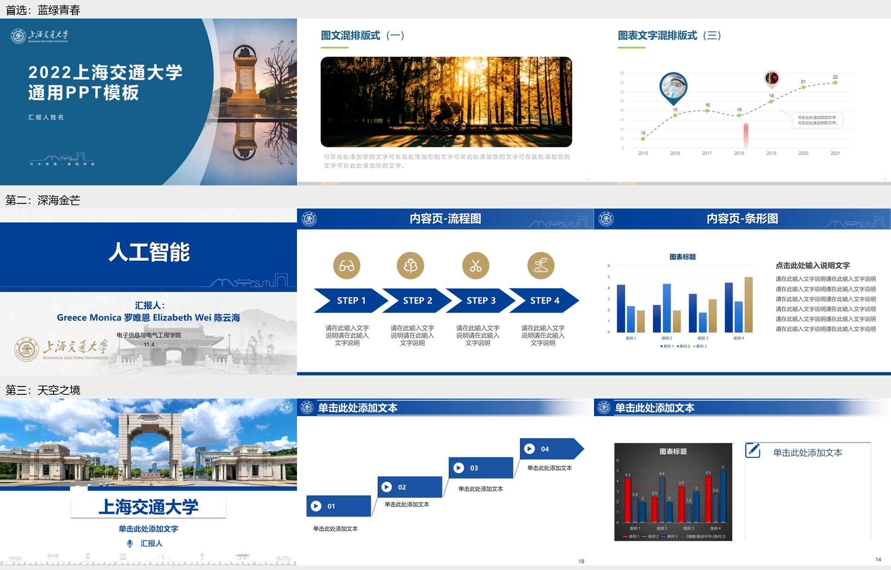

# 虚拟嗅觉汇报：三个模板建议

2026-11-01。本轮只做选型与只读审阅，尚未制作本课 PPT，也未提交或推送 GitHub。

**首选《诗意校园·2022蓝绿青春》；第二选《深海金芒》；第三选《天空之境》。** 三者都采用 16:9，正文以浅底为主，便于同一场汇报放入设备照片、实现图和实验结果。首选的蓝绿与留白更适合本课“感官体验、技术解释、证据判断”并重的内容。最终风格由陈云海决定，本轮推荐没有把颜色或模板变成已确认要求。

以上均是原模板的原有页面导出，尚未替换成本课内容。不是拟制样页，也没有将模板中的示意数字当成研究结果。

## 快速比较

| 顺位 | 原文件 | 适合本课的实际版式 | 主要取舍 |
| --- | --- | --- | --- |
| 1 蓝绿青春 | 原 PPTX（本机参考，仓库不附原件） | 大图、图文、时间线、曲线、比较表都已有；主色蓝，少量亮绿 | 叙事、设备与证据页较平衡；原正文浅灰，需要加深 |
| 2 深海金芒 | 原 PPTX（本机参考，仓库不附原件） | 四步流程、表格、条形图、分组图示 | 技术解释最省改造；目录和封面已填入旧《人工智能》内容，须完整清理 |
| 3 天空之境 | 原 PPTX（本机参考，仓库不附原件） | 双栏比较、四步过程、四图案例、图表加解释 | 适合图像与短视频较多的讲法；蓝色渐变标题条、阴影和黑底图表需要减轻 |

### 1．首选：诗意校园·2022蓝绿青春

[封面、图文、过程与数据页预览](previews/candidate_09/contact.png)。抽看原第 2、19、24、28、29 页。

采用它的理由：第 19 页的大图能给一次真实体验或设备照片留出足够空间；第 24 页的过程版式可改为一条实现链；第 28、29 页能承接结果与证据比较。蓝绿视觉较轻，既能讲装置，也能讨论多感官与健康研究，保持通识课的亲近感。

本课尤其需要分开呈现“装置能够怎样释香”“研究测到了什么体验或健康相关变化”“在什么条件下有效或可用”。首选的过程页与比较表可以分别承载它们。建议证据表直接列出“宣称／实际测量／对照结果／限制”，原研究图旁留一块解释区，避免把能做出装置的证据移用为健康效果证据。

若选它，建议保留蓝色标题、少量绿色强调与浅底；把校园图片换成已核源的场景或装置照片；将灰色说明字加深，并给来源和条件留出固定底栏。过程页按本课讲法重新排对象与动作，结果页换成真实研究图或经核源重绘图。模板里的曲线、年份、比例全部删除或替换。

局限：原文件 50 页包含大量备选和资源页，绝不能按模板页数铺满 12 分钟。部分示范版式正文多而浅，照抄会影响投影。当前只确认静态原生导出，课堂投影与正式讲述仍待后续检验。

### 2．技术解释优先：深海金芒

[封面、流程、表格与数据页预览](previews/candidate_05/contact.png)。抽看原第 1、4、5、6 页。

采用它的理由：四步流程已经明确划分对象与说明区，便于解释虚拟场景、控制与释香装置之间怎样配合；表格、条形图和纯白页可以承接设备比较与结果。大学历史《马原》汇报也使用了这个视觉家族，属于用户实际用过的路径。

若选它，先另存工作副本，再逐页清除旧《人工智能》的题目、成员、目录与日期。保留白底与蓝色层级，金色只作少量辅助。原流程中的眼镜、脑、工具等图标与本课机制没有证据关联，需按核实后的过程替换。图表需补齐对象、样本、对照、单位和来源，讲稿承担较长解释。

局限：当前文件已经被填过内容，不能直接视作空白模板。厚标题条会占用一部分画面。不能因旧汇报用过它，就推断用户已经指定本课继续用它。

### 3．图片与案例优先：天空之境

[封面、双栏、数据、过程与图片页预览](previews/candidate_04/contact.png)。抽看原第 1、10、14、18、20 页。

采用它的理由：四图页适合少量真实设备或场景的辨认，双栏适合比较两种实现方式，过程页可承接一次使用流程。大学英语汇报实际采用过同一模板，本人对这类视觉已有使用经验。

若选它，保留统一蓝色标题和图片区域，替换校园封面，弱化渐变、阴影与装饰线。第 18 页的上升阶梯容易让人读成“越来越先进”，讲工作流程时宜改成等高的水平步骤。第 14 页的黑底复合图表应换成简洁浅底图，并按论文真实比较关系排版。

局限：原例子有较重的校园宣传感，科学解释需要换图、留白与减装饰。若主要内容是机制和证据表，前两个候选更直接。

## 大学历史材料看到了什么

明确偏好与文件推断分开使用：

- **已有明确记录**：实际读取 Pre协作经验（本机参考，仓库不附原件）。其中确认先审方案与样页，主线有阶梯，PPT和口播分工，一页一个主要意思，按内容选择图示并保持全场统一，最终看真实渲染。这些要求适用于本轮选型。该记录没有指定本课必须用蓝色、绿色、暗色或某个模板。
- **从大学文件推断**：AI V5-06／V5-07 是米白底、深色字、青绿和橙色区分机制与比较；英语汇报用蓝白校园模板；马原汇报用深海金芒式蓝白；美学用暗底、酒红与金色。跨课文件显示用户会随内容换风格，支持“清楚层级、真实图像、流程或比较”这类共同点，无法据此认定唯一喜爱的颜色。
- **具体审阅范围**：V5-06 原第 1、4、19 页，V5-07 原第 1、10、19 页；英语原第 1、6、14 页；马原原第 1、14、17 页；美学最终版原第 1、7、9 页，均重新后台原生导出后查看。另读 V5 已有第 4、10 页预览作为定位参考。没有审核这些旧汇报的全部页面、口播、事实或课堂反馈。
- **旧文件中的问题也保留**：马原第 17 页静态导出出现文字重叠，XML 确有动画时间信息；本轮未播放其动画，无法判断当时逐步显示效果，因此不把该页的静态拥挤当成用户喜欢的设计。美学部分文字较密也只视为该课成品特征，本课 12 分钟口头汇报另按投影可读性取舍。

历史审阅文件：

| 文件 | 本次用途 |
| --- | --- |
| 智能体产业研发 V5-06（本机参考，仓库不附原件） | 看标题、比较和来源的位置 |
| 智能体产业研发 V5-07（本机参考，仓库不附原件） | 看机制流程与多栏的实际呈现 |
| 大学英语汇报（本机参考，仓库不附原件） | 确认天空之境实际使用记录 |
| 马原汇报（本机参考，仓库不附原件） | 确认深海金芒视觉家族与比较表 |
| 美学最终版（本机参考，仓库不附原件） | 判断暗色、照片和过程页的跨课变化 |

历史预览含个人课程材料，仅存放在已设忽略规则的 `private/` 目录，本轮没有复制其中的私人叙述到本课文稿。缺口：这些视觉由谁逐项决定、是否本人最满意、教室投影效果和课堂反馈，本轮均未知。

## 其他候选为什么暂不入前三

已盘点目录内 11 份 PPTX，查看有预览的原有缩略图，并对 10 份宽屏模板各抽看封面和内容页。简单蓝的 4:3 版本仅盘点和看原有缩略图，优先研究了其 16:9 版本。

| 候选 | 依据与本次取舍 |
| --- | --- |
| 简单蓝 16:9 | 第 1、6、8、11、13 页清楚、克制，但主要是空框架。现成机制和数据版式少，需自行搭建的内容比前三个更多，可作为用户希望极简时的替补 |
| 百廿红 | 第 1、14、15 页庄重，以校园介绍和文字版式为主，本课的设备、流程、研究结果需要另做较多安排 |
| 浩瀚星河 | 第 1、12、18 页封面醒目，内页蓝金与校园照片较突出；可用，但正文解释与证据比较的现成组织弱于前三 |
| 鎏金岁月 | 第 1、7、11 页都叠加暗色照片、线条与黄色装饰，本课原理图和论文图需处理背景，额外改造较多 |
| 诗意校园·酒红醉人／赤霞银珠 | 已看第 1、11、16／18 页。浅底内页可用，但红色和校园活动感较强，本课暂无需要这种基调的内容依据 |
| 诗意校园·暗夜奔驰 | 已看第 1、11、18 页。暗底适合短暂营造沉浸氛围，但灰字对比与白底论文图片衔接都需修整；不建议为了“VR”字样就全场采用暗底 |

## 验证与原件保护

使用现有 Python、Pillow、pywin32 和本机 PowerPoint 16.0。复用了既有 V5 `export_deck.py` 的后台只读导出方法，只保留 Open(ReadOnly, WithWindow=0) 与 Slide.Export；没有沿用其复制后改内容、删除媒体或 SaveAs 的部分。本轮没有安装依赖，没有显示演示窗口、播放幻灯片、移动鼠标或发送按键。

[候选盘点](候选盘点.json)保留页数、尺寸、原文定位和导出前 SHA256；[渲染记录](渲染记录.json)保留抽看页码与导出结果；[原件完整性核验](原件完整性核验.json)回读全部模板及本次历史样本的 SHA256，全部一致。静态渲染仅证明当前机器上的这些原有页面可查看，后续正式样页仍需检查字号、图示、来源和投影效果。

三个推荐原件的 SHA256：

| 原文件 | SHA256 |
| --- | --- |
| 诗意校园·2022蓝绿青春 | `169d1ef0103060773807880c49328d1d538114bba5ef1061b2b865171cab826c` |
| 深海金芒 | `bb11e01611a1a2703d3784e62102ae0d296d9972743bd16deb5ca752b8912f21` |
| 天空之境 | `559779601502f740dedc74ff6cae4fd42ae5093b57c9d7fcd4352495192b2c27` |

一次较宽的桌面文件名枚举触及通讯缓存路径，未打开其内容；随后将历史材料检索限定在大学学习课程目录与用户指定参考目录。后续沿这一路径边界继续。

选择完成后，下一阶段仍先把同一内容试排为开场、机制与证据的少量样页，再由用户看实际页面决定是否展开全套。此处只是下一阶段建议，本轮未执行。

## 本轮八条检查

1. **以误认目标为耻，以明确成效为荣**：交付三个可比较的模板与真实页面，保留用户拍板；本课 PPT 尚未制作。
2. **以无据断言为耻，以查证求实为荣**：原生渲染后再推荐，明确记录抽看页码，区分明确偏好和文件推断。
3. **以闭门造轮为耻，以择优复用为荣**：比较现有模板与大学成品，复用现有后台导出方法；每个推荐都说明保留与改造部分。
4. **以照单全收为耻，以独立判断为荣**：未因 VR 题目就选暗底；优先考虑流程、原图、对照和限制是否放得清楚。
5. **以表面达标为耻，以实物验收为荣**：看实际导出页，并用前后哈希核验原件；课堂投影和动画仍待后续检查。
6. **以无声中断为耻，以有据续作为荣**：候选、预览、渲染记录和推荐均本地保存，下一步先由用户选风格。
7. **以无效消耗为耻，以及时收敛为荣**：已有三项足够比较，停止新增样本；历史文件只抽看有代表性的页面。
8. **以黑箱推进为耻，以主动汇报为荣**：候选变化、旧内容残留、动画静态导出问题及检索范围纠正均据实交代。
